# Flatcap for Gitea

  

<p align="center">
  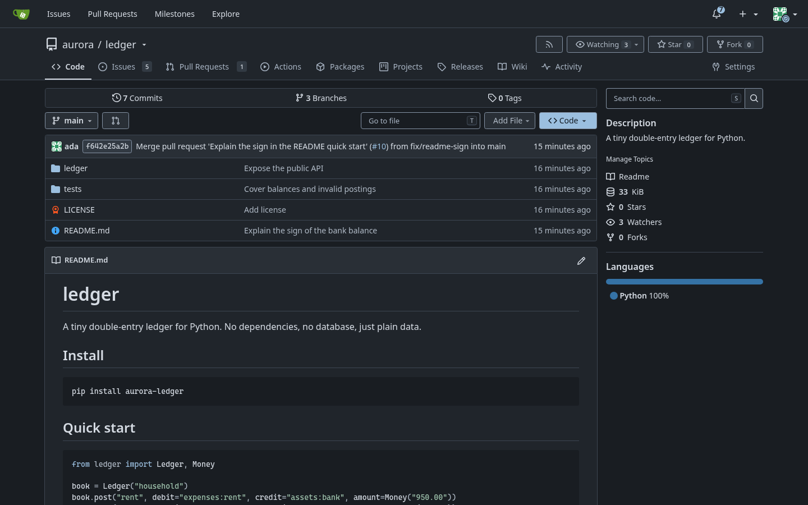
</p>

<p align="center">
  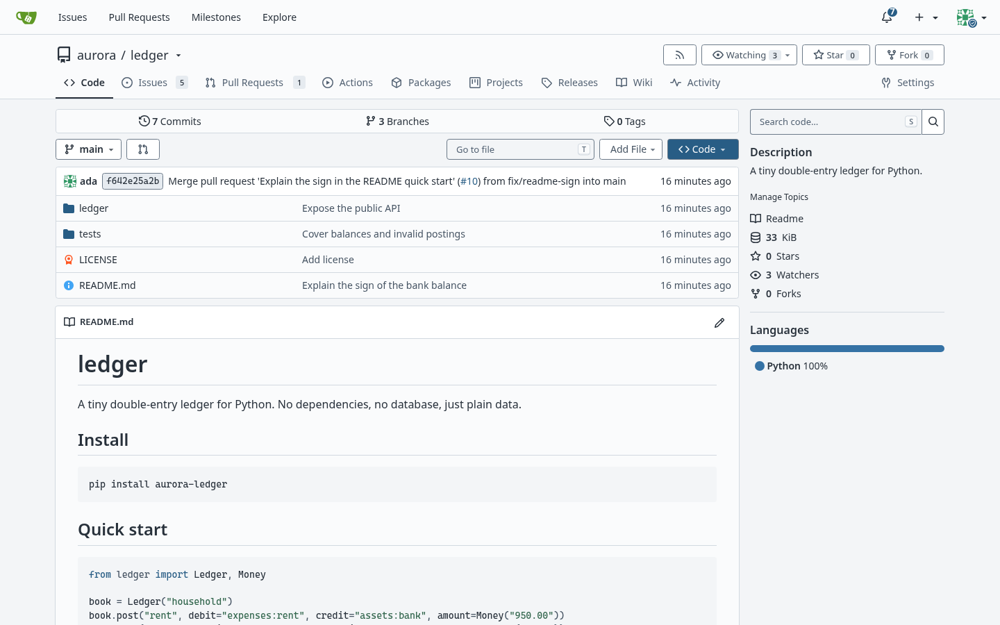
</p>

<p align="center"><sub>Flatcap Slate (dark) above, Flatcap Daylight (light) below, on a Gitea 28.2.0 demo repository.</sub></p>

<table>
  <tr>
    <td width="50%">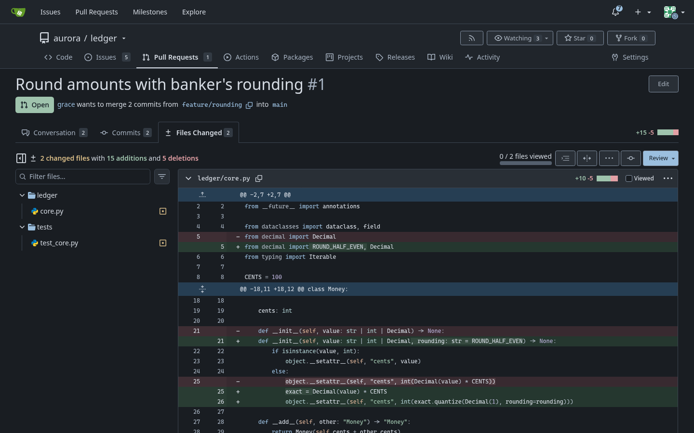</td>
    <td width="50%">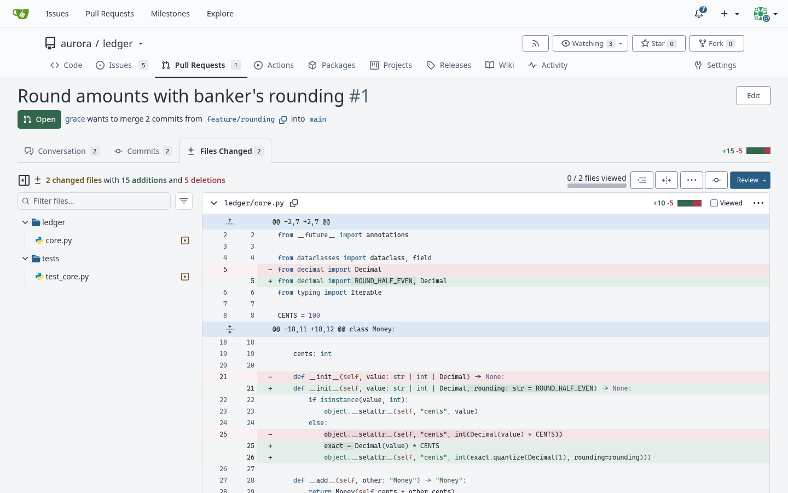</td>
  </tr>
  <tr>
    <td>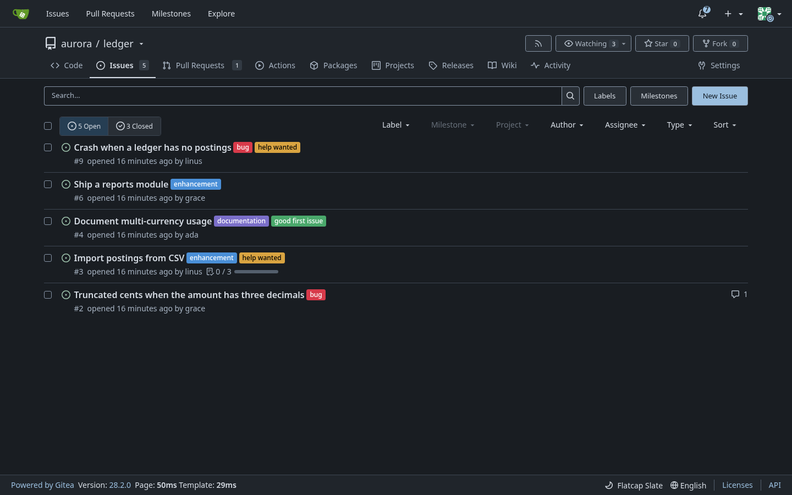</td>
    <td>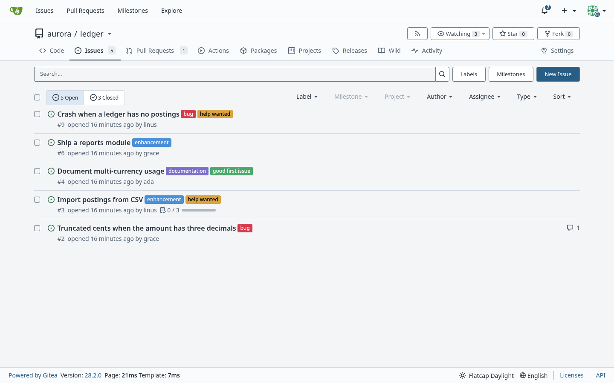</td>
  </tr>
  <tr>
    <td>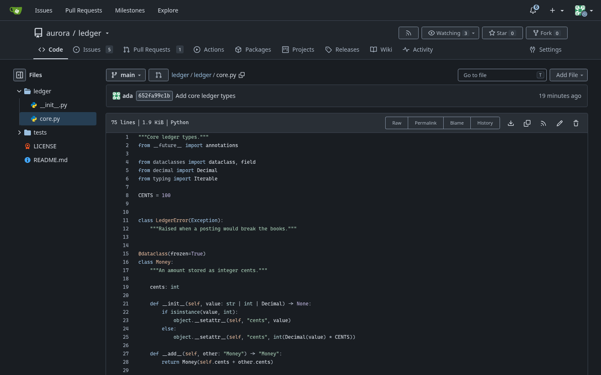</td>
    <td>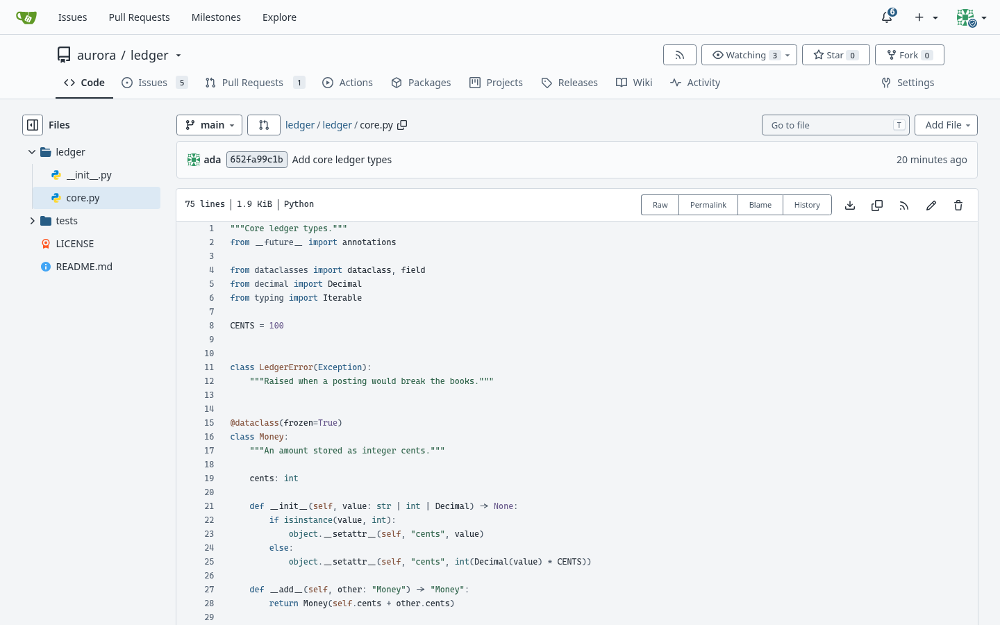</td>
  </tr>
  <tr>
    <td align="center"><sub>Slate</sub></td>
    <td align="center"><sub>Daylight</sub></td>
  </tr>
</table>

<p align="center"><sub>The screenshots above use demo data only (users, organization and repository were created for them).</sub></p>

<table>
  <tr>
    <td width="50%">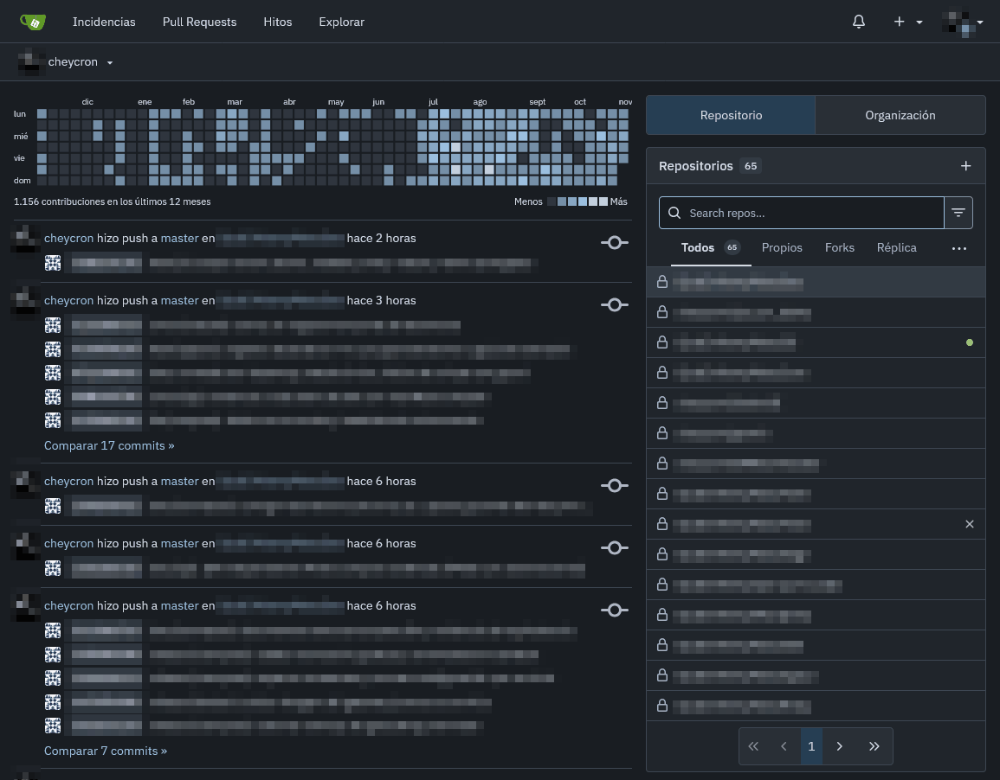</td>
    <td width="50%">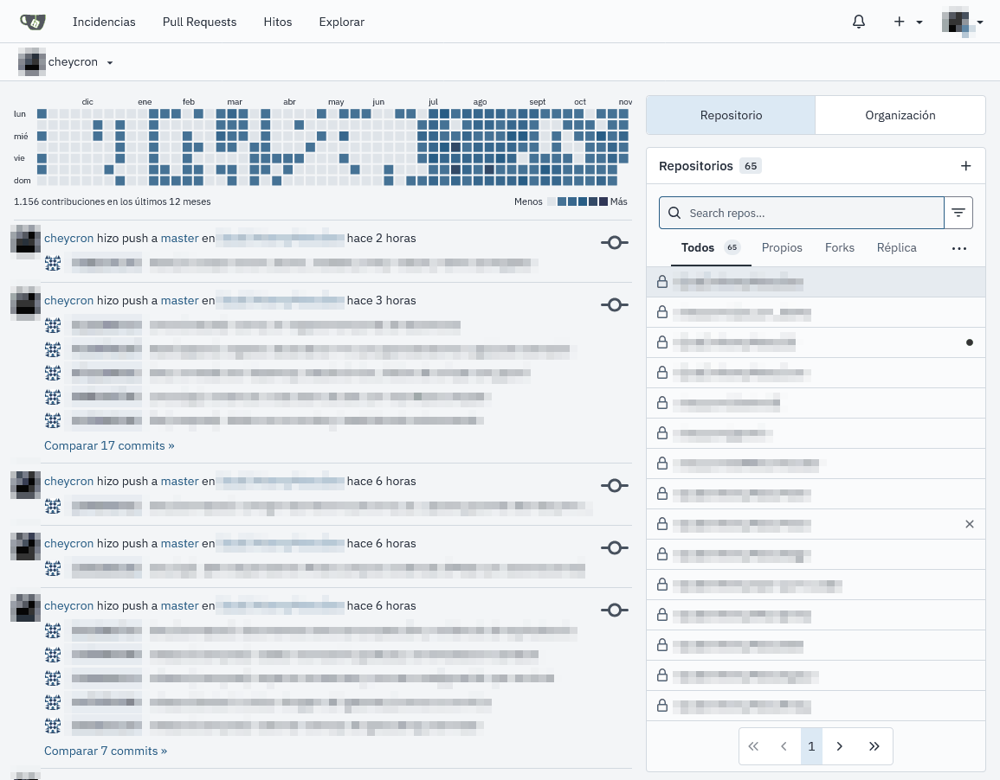</td>
  </tr>
  <tr>
    <td>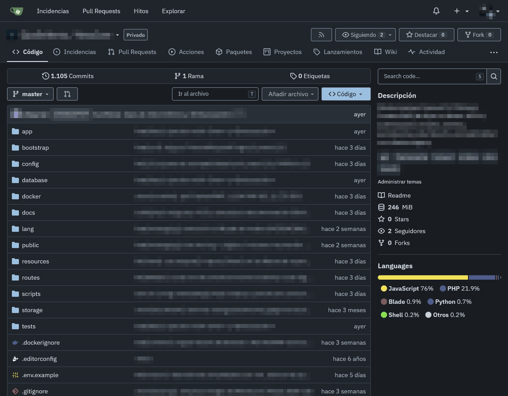</td>
    <td>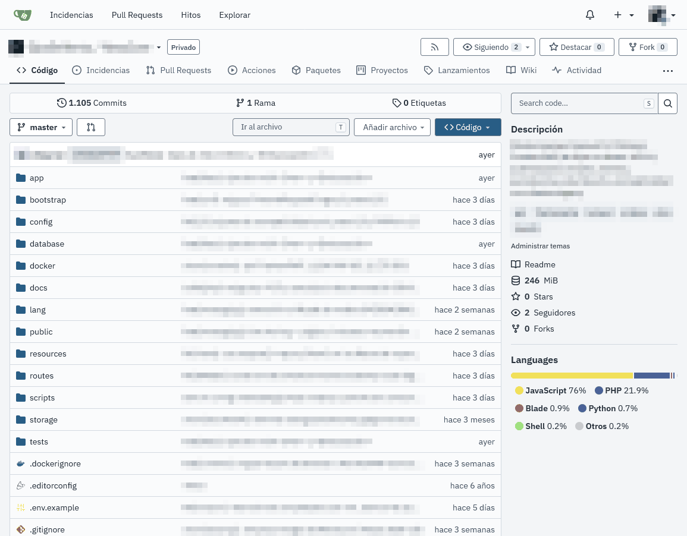</td>
  </tr>
  <tr>
    <td align="center"><sub>Slate</sub></td>
    <td align="center"><sub>Daylight</sub></td>
  </tr>
</table>

<p align="center"><sub>On a real self-hosted instance (private names blurred).</sub></p>

**Flatcap for Gitea** brings the Flatcap visual system to your forge: matte graphite surfaces, one mineral-blue accent, IBM Plex Sans for the interface, Cascadia Code for code and diffs.

It is three Gitea themes, **Flatcap Slate** (dark), **Flatcap Daylight** (light) and **Flatcap (auto)**, which follows the system. Every color comes from the Flatcap 2.0 core; each one is a plain CSS file, with no build step on your server.

> The interface organizes. Content takes the foreground. Color informs.

## Install

Requires **Gitea 28.2** or newer. A custom theme is one file, `theme-<name>.css`, in the `public/assets/css/` folder of Gitea's custom directory (`$GITEA_CUSTOM`). The three files are in [`themes/`](https://github.com/cheycron/flatcap-gitea/tree/main/themes).

### Docker (rootful image, `gitea/gitea`)

The image sets `GITEA_CUSTOM=/data/gitea`, so the files go in the `/data` volume:

```sh
docker cp themes/. gitea:/data/gitea/public/assets/css/
docker exec gitea chown -R git:git /data/gitea/public
```

Or, with the volume bind-mounted on the host (for example `/srv/gitea/data`), copy them to `/srv/gitea/data/gitea/public/assets/css/`. Create the folder if it does not exist.

### Docker (rootless image, `gitea/gitea:*-rootless`)

The rootless image sets `GITEA_CUSTOM=/var/lib/gitea/custom` and reads `/etc/gitea/app.ini`. Put the files in `/var/lib/gitea/custom/public/assets/css/` of the `/var/lib/gitea` volume.

### Binary install

Copy the files to `custom/public/assets/css/` next to the binary (the default custom path is `<work path>/custom`), or to `$GITEA_CUSTOM/public/assets/css/` if you set it. The path is shown under *Site Administration → Configuration*.

### Register the themes

Add this to `app.ini` (`/data/gitea/conf/app.ini` in the rootful image), keeping the built-in themes, then restart Gitea:

```ini
[ui]
THEMES = gitea-auto,gitea-light,gitea-dark,flatcap-auto,flatcap-slate,flatcap-daylight
; Optional: the theme new visitors and signed-out pages get.
DEFAULT_THEME = flatcap-auto
```

`THEMES` lists what users can choose; the names are the file names without `theme-` and `.css`. Without `DEFAULT_THEME`, Gitea keeps `gitea-auto`. Gitea reads the theme files at startup, so restart it after adding or updating them.

## Use it

Open *Settings → Appearance* and pick a theme. A user's choice overrides `DEFAULT_THEME`.

<!-- build:themes -->
| Theme | File | Mode | Variables |
| :--- | :--- | :--- | ---: |
| Flatcap (auto) | `theme-flatcap-auto.css` | follows `prefers-color-scheme` | 298 per mode |
| Flatcap Slate | `theme-flatcap-slate.css` | dark | 298 |
| Flatcap Daylight | `theme-flatcap-daylight.css` | light | 298 |
<!-- /build:themes -->

`Flatcap (auto)` is self-contained: it holds the light and the dark set and switches with `prefers-color-scheme`, as Gitea's own *Auto* does. You do not need to install the other two files for it to work.

## Fonts

<!-- build:fonts -->
| Use | Stack (exact) |
| :--- | :--- |
| Interface (`--fonts-proportional`) | `"IBM Plex Sans", "Segoe UI", system-ui, sans-serif` |
| Code (`--fonts-monospace`) | `"Cascadia Code", "Cascadia Code NF", "CaskaydiaCove Nerd Font Mono", ui-monospace, Consolas, monospace` |

The themes do not install fonts. Without IBM Plex Sans or Cascadia Code on the device, the stack falls back to Segoe UI, system-ui, Consolas or the system monospace font.
<!-- /build:fonts -->

See the [Flatcap typography guide](https://github.com/cheycron/flatcap-theme/blob/main/docs/typography.md).

## Accessibility

Contrast is checked for the pairs Gitea actually combines (text on each surface, links, primary and colored buttons, labels, diff lines with their code tokens, feedback messages, selection, focus ring, syntax on the code background, the Actions log, chart series) against the contracts of the [Flatcap core](https://github.com/cheycron/flatcap-theme): 7:1 for primary text, 5:1 for informative text, 3:1 for functional outlines and data marks, 4.5:1 for text on fills. `python3 scripts/build.py --check` fails if any pair misses its target.

Limits that affect you: these are token-level numbers measured on the values the themes set. They do not prove how every Gitea page renders. Label colors chosen by repository owners, language colors and file-type icons keep their own colors. The focus ring and the text selection are the only two CSS rules in the themes; everything else is variables.

Every pair with its measured ratios is in the [full mapping](https://github.com/cheycron/flatcap-gitea/blob/main/docs/mapping.md); the before/after scan is in the [QA report](https://github.com/cheycron/flatcap-gitea/blob/main/docs/qa-report.md).

## Compatibility

- Variable names were verified against Gitea 28.2.0 (the built frontend of `gitea/gitea:28.2.0`). Every variable the built-in themes declare is set, because a custom theme replaces the built-in one. Another Gitea version may add or rename variables; `scripts/inventory.py` rebuilds the inventory from any release.
- Rendering was checked in Chrome for Testing 149.0.7827.55 (Playwright) at 1440×900 in both modes, plus the auto theme with emulated `prefers-color-scheme`. Firefox, Safari and mobile layouts were not tested.
- User-defined issue labels, the repository language bar, file-type icons, the Gitea and Git logos in images, and native browser controls keep their own colors. See the [limitations](https://github.com/cheycron/flatcap-gitea/blob/main/docs/mapping.md#limitations).
- `--color-white` carries the text on every colored fill, so in Slate it is the dark `accent.on` color, not white. Custom CSS of yours that expects `--color-white` to be white will differ.

## Contributing

`themes/*.css` and the generated README and docs blocks are produced from `src/theme.json`; do not edit them by hand. Change values in the Flatcap core and refresh them with `python3 scripts/build.py --sync`; mapping changes must name a variable that exists in `src/gitea-inventory.json`. Run `python3 scripts/build.py --check` before opening a pull request. Mapping details are in [docs/mapping.md](https://github.com/cheycron/flatcap-gitea/blob/main/docs/mapping.md).

## License

MIT © Cheycron Blaine. See [LICENSE](https://github.com/cheycron/flatcap-gitea/blob/main/LICENSE).

## Support

If Flatcap makes your workspace calmer, you can support its development.

<p align="center">
  <a href="https://www.buymeacoffee.com/cheycron">
    
  </a>
</p>
